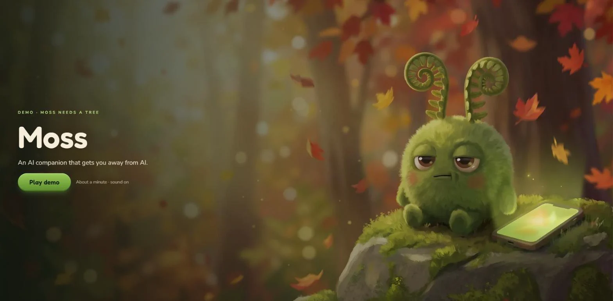
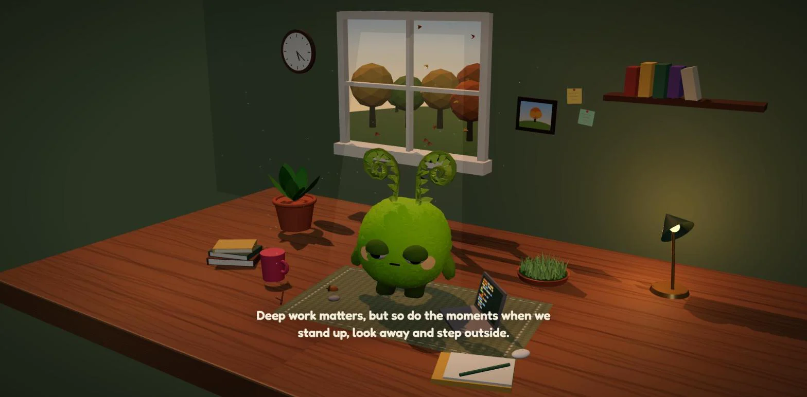
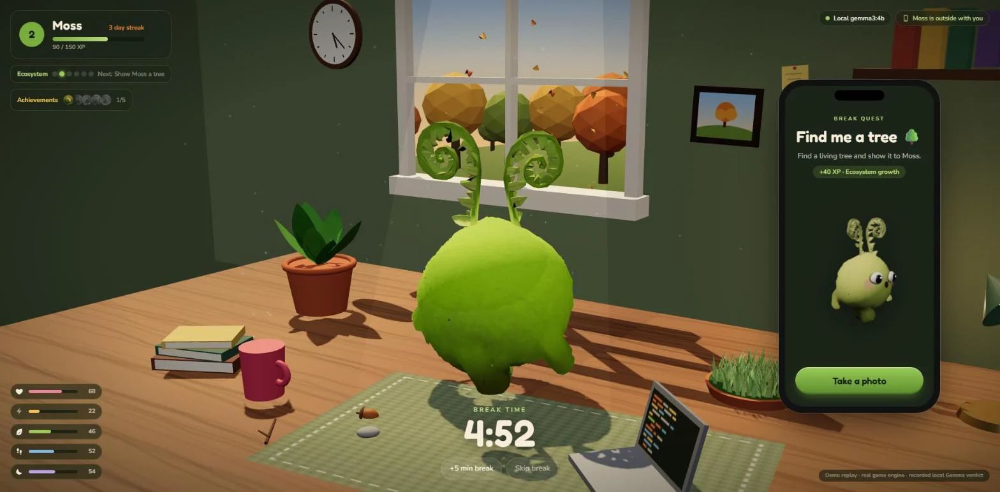
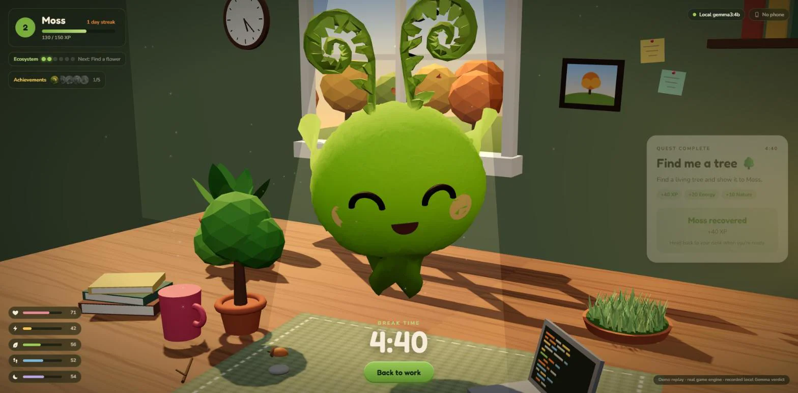
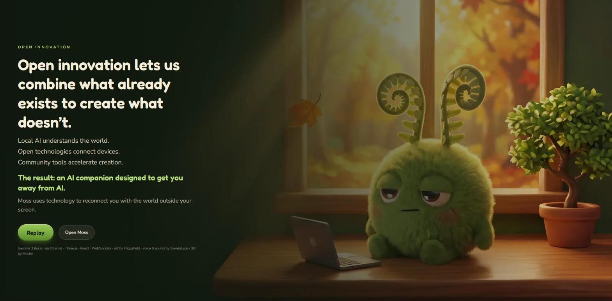

# Moss

[](https://github.com/Reterics/hacktoberfest_touch_grass/actions/workflows/ci.yml)


-4285F4?logo=google&logoColor=white)




A local-first AI productivity companion: **Tamagotchi × focus timer × outdoor quests.**

Moss is a small forest creature that works beside you on your laptop. When a focus session ends, Moss develops a need that can only be met in the physical world. You take your phone outside, photograph a tree (or grass, or a flower), and local **Gemma 3 4B** checks the photo. Moss recovers, and its tiny desk ecosystem grows.

Everything runs on your machine. Photos travel only over your local Wi-Fi, and no cloud AI is involved.

| | |
|---|---|
|  |  |
| **Focus:** Moss works beside you while you work. | **Break:** Moss needs a tree, so you take the phone outside. |
|  |  |
| **Reward:** local Gemma confirmed the tree; Moss recovers and the desk ecosystem grows. | **Why:** an AI companion designed to get you away from AI. |

**▶ Demo video:** [youtu.be/jfAM9tN1Dsg](https://youtu.be/jfAM9tN1Dsg) · **Code:** [github.com/Reterics/hacktoberfest_touch_grass](https://github.com/Reterics/hacktoberfest_touch_grass)

Or watch the whole loop in about 90 seconds in the app itself: open `/?demo=1` ([details below](#demo-moss-needs-a-tree)).

## Hacktoberfest Open-Source AI Challenge

Built for the [Hacktoberfest Open-Source AI Challenge, Week 1: Touch Grass](https://dev.to/challenges/hacktoberfest-week1-2026-10-05). Prize categories:

- **Best Use of Gemma:** Gemma 3 4B runs locally through Ollama and does all of Moss's runtime AI work. It writes the quest wording, checks the outdoor photo with vision, and writes Moss's reactions. Its output is schema-validated, and the deterministic game engine, not the model, decides XP and stats.
- **Best Use of ElevenLabs:** all of the demo's audio comes from ElevenLabs: Moss's deadpan voice (v3), the narration, sound effects and the music bed. It was generated at design time and ships as local files, so the app still runs offline.

## Quick start

Requirements: **Node 22.13+**, **pnpm 9**, and **[Ollama](https://ollama.com)**.

```bash
ollama pull gemma3:4b      # ~3.3 GB, once
pnpm install
pnpm dev                   # backend on :3000, web on :5173
```

Open <http://localhost:5173> on the laptop. When a break starts, scan the QR code with a phone on the **same Wi-Fi**.

- **Short demo loop:** pick **Demo 30s / 2m** in the preset selector next to *Start focus*.
- **Windows:** the first time the server binds to the network, Windows Firewall asks for permission. Allow it on **private networks**, or the phone can't connect.
- **Wrong IP in the QR code?** Set `MOSS_PUBLIC_HOST=192.168.x.x` in `.env` (see `.env.example`).

### Production mode

```bash
pnpm build && pnpm start   # one server on :3000 serves the API, the desktop UI and the phone companion
```

## Demo: "Moss Needs a Tree"

Open `http://localhost:5173/?demo=1` (or `:3000/?demo=1` in production mode) and press **Play demo**. A voiced, roughly 90-second replay of [docs/DEMO-SCENE.md](docs/DEMO-SCENE.md). It opens on the problem (too much screen time, skipped breaks) and the idea, then the gameplay: the focus session ends, Moss asks for a tree, heads out on the phone, a tree is photographed and recognized, the desk ecosystem grows, and work resumes. It ends on the open-innovation card.

- It needs no server, Ollama or phone, and never writes game data.
- Every state change goes through the real game engine on a scripted clock (`apps/web/src/demo/script.ts`, covered by a test). The engine itself picks the tree quest from Moss's lowest need, and computes the XP and the tiny-tree unlock.
- The photo verdict is a **recorded** run of local Gemma on the same photo, not a made-up one. Re-run it with `pnpm --filter @moss/server exec tsx scripts/verify-demo-photo.ts <photo.jpg>`, which rewrites `apps/web/src/demo/gemma-verdict.json`.
- Voice, SFX and music were generated with ElevenLabs, and the tree photo and cards with Higgsfield, at design time. All of them ship as local files in `apps/web/public/assets/demo/`.

## The loop

```text
Focus → Moss develops a need → Gemma words a quest → phone (QR) → photo
      → Gemma validates → game engine applies rewards → Moss reacts
      → desk ecosystem grows → next focus session
```

## Architecture

```text
apps/
  server/        Fastify + WebSocket + node:sqlite. Owns the authoritative game state.
  web/           React + Vite + Tailwind + Three.js (react-three-fiber).
                   /           desktop diorama (3D Moss, HUD, quest panel + QR)
                   /companion  lightweight phone page (no Three.js)
packages/
  shared/        Types and the laptop <-> phone protocol
  game-engine/   Pure, deterministic rules: timers, stats, XP, quests, unlocks (+ tests)
  ai/            AIProvider abstraction, OllamaProvider, Moss prompts, zod-validated outputs (+ tests)
docs/            Product, architecture, game design, visual direction
```

Key rules (see `CLAUDE.md` and `docs/`):

- **The engine decides, the AI suggests.** The engine picks the need and the quest template, and the template fixes the rewards. Gemma only rewrites the wording, and the result is validated (length, safety, and that it still names the vision target). For photos, Gemma returns `{success, confidence, detected, reason}`, and the engine applies its own confidence threshold.
- **AI failure never blocks the loop.** If Ollama is down, quests use built-in wording, and photo quests offer *Complete manually* (half XP). The desktop shows a setup banner with the exact fix command.
- **Quest wording is prefetched** about 25 s before focus ends, so the break starts with Gemma's text ready.
- **Security:** timer controls only accept requests from the laptop itself. The phone needs a pairing token from the QR code (random, expires after 12 h). Uploads are size-limited and checked by magic bytes, and photos are held in memory for validation, never written to disk. Ollama stays on localhost and is reached only through the backend.

The single balance table lives in `packages/game-engine/src/balance.ts`. Its header comment records the decisions made for the open questions in `docs/GAME-DESIGN.md`.

## Scripts

| Command | What it does |
|---|---|
| `pnpm dev` | Backend (watch mode) and Vite dev server, both reachable on the LAN |
| `pnpm test` | Vitest: engine rules and AI validation (no Ollama needed) |
| `pnpm typecheck` | TypeScript across all packages |
| `pnpm build` / `pnpm start` | Production bundle, then a single server on :3000 |

## Configuration

See `.env.example`: `OLLAMA_HOST`, `OLLAMA_TEXT_MODEL`, `OLLAMA_VISION_MODEL` (separate on purpose), `MOSS_PORT`, `MOSS_PUBLIC_HOST`, `MOSS_DATA_DIR`.

## Visuals

Moss's canonical design, character sheet and asset pipeline are documented in [`visuals/README.md`](visuals/README.md). On the desktop, Moss is a faceless Meshy-generated GLB body with a live Three.js face and shader-driven fern fronds. On the phone, Moss is drawn from sprites cut out of the expression sheet. Game state maps deterministically to visual states through a `VisualStateController` (`apps/web/src/lib/visualState.ts`). Preview any state with `/?visual=<state>`. Moss hops when a break quest appears or completes, walks out toward the window while a paired phone carries the quest, and walks onto the phone screen. Five achievements, each with its own art, are earned deterministically by the game engine (`ACHIEVEMENT_RULES` in `packages/game-engine/src/balance.ts`). Higgsfield and Meshy are design-time only, never runtime.
