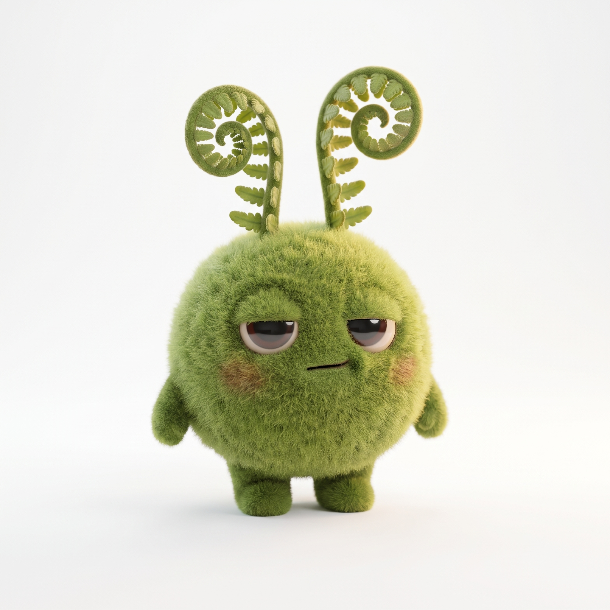

# Moss Visual Bible

The source of truth for how Moss looks. These files are design-time references, not runtime dependencies (see `docs/VISUAL-DIRECTION.md`).

## Canonical character

**Moss** is a fluffy round puff of spring-green velvety moss with two curled fern fiddleheads on top of its head.

- **Silhouette:** a round body plus two tall curled fronds. It reads instantly at small sizes.
- **Body:** a slightly bottom-heavy sphere with tiny nub arms and two short round moss feet.
- **Face:** heavy half-lidded glossy dark eyes with whitish sclera. One lid sits a touch lower than the other. A small flat mouth, faint rosy cheeks.
- **Personality:** deadpan, dry and slightly sarcastic, but affectionate. The resting face is *unimpressed*, not cute-smiley, which matches Moss's voice in `packages/ai/src/prompts.ts`.
- **Fronds are expressive.** They droop outward when Moss is tired or asleep and straighten when it's excited.

The design merges concept **05 Fern sprite** (anatomy) with concept **06 Turf block** (personality).

## Files

| File | What it is |
|---|---|
| `references/moss-master-front.png` | Canonical master: front view, deadpan expression. **Always use this as the reference for new generations.** |
| `references/moss-turnaround.webp` | Turnaround: front, three-quarter front, side, three-quarter rear, back |
| `references/moss-expressions.webp` | Expressions: neutral, happy, excited, tired, concerned, annoyed, curious, sleeping |
| `references/moss-expressions-cutout.webp` | Expression sheet with the background removed (source of the phone sprites) |
| `references/moss-base-front.webp`, `moss-base-side.webp` | Faceless body views used as Meshy input |
| `references/master-candidate-b.webp` | The runner-up master candidate (candidate A became the master) |
| `concepts/moss-concept-0*.webp` | The six exploration concepts |
| `meshy/moss-body-raw.glb` | Raw Meshy 7.1 output (12.4k triangles, embedded 2K texture) |
| `meshy/moss-walk-raw.glb`, `meshy/moss-hop-raw.glb` | Meshy auto-rig output: the same skinned body with the free `walking` clip, and the custom `Hop_with_Arms_Raised` clip (action 417) |
| `demo/demo-*.webp` | Demo scene art: the phone's tree photo, the title card and the end card (Higgsfield) |
| `achievements/achievement-*.webp` | Achievement art sources (Actually Touched Grass, Forest Friend, Photosynthesis, Chlorophyll Addict, Outdoor Engineer) |

The master is a lossless PNG. The other references are stored as quality-92 WebP to keep the repository small.

## Runtime assets

| Asset | Path | Source |
|---|---|---|
| 3D body (faceless) | `apps/web/public/assets/models/moss-body.glb` | Meshy, optimized with gltf-transform (meshopt + 1024px WebP, 301 KB) |
| Phone mood sprites | `apps/web/public/assets/moss/mood-*.webp` | Cut from the expression-sheet cutout, 384px tall |
| Rigged body (`walk`, `hop`) | `apps/web/public/assets/models/moss-rigged.glb` | Meshy rig plus clips, merged by `scripts/build-moss-rig.mjs`, then optimized (452 KB) |
| Phone motion strips | `apps/web/public/assets/moss/moss-walk.webp`, `moss-hop.webp` | Baked from the rigged body with the live face (12 and 24 frames, 320×384) |
| Achievement art | `apps/web/public/assets/achievements/<id>.webp` | Higgsfield, 512px |
| Demo images | `apps/web/public/assets/demo/*.webp` | Higgsfield (the tree photo is plain photography; the cards use the master as the reference) |
| Demo audio | `apps/web/public/assets/demo/audio/*.mp3` | ElevenLabs: Moss's lines (v3, voice "Cavendish"), intro and end-card narration (v3, "Carolyn"), SFX (Sound Effects v2), music bed (Music v2.5). Silence-trimmed and loudness-normalized with ffmpeg |

The 3D body is deliberately **faceless**. Eyes, heavy upper lids, mouth and cheeks are rendered live in Three.js (`apps/web/src/desktop/MossModel.tsx`), so blinking and every expression stay dynamic. The fern fronds bend in a vertex shader driven by each visual state's `droop` value. Expression values per state live in `VISUAL_PROFILES` (`apps/web/src/lib/visualState.ts`). Preview any state with `http://localhost:5173/?visual=<state>`.

## Motion

- **Desktop:** the static body handles every expression. When a break quest appears or completes, the Meshy-rigged body takes over for the **hop**. The live face rides on the bone that most influences the face area (found from skin weights), and the clip's own hip lift is amplified 2.5× so the hop clears the desk. When a paired phone carries an open quest, Moss **walks** to the window and shrinks away ("Moss is outside with you"), then walks back when the quest completes or the phone disconnects.
- **Phone:** stays 2D. Moss walks onto the quest screen, hops, and settles into the painted pose. A timer quest shows the walk loop; a completed quest plays the hop.
- **Re-baking the phone strips:** run `pnpm dev`, open `http://localhost:5173/?bake=walk` (then `?bake=hop`), and keep the tab focused. A dev-only Vite endpoint saves the strip into `public/assets/moss/`.

## Pipeline used

1. **Higgsfield, Nano Banana Pro:** 6 concepts, then a hybrid master from concepts 05 and 06 (2 variants).
2. Turnaround and expression sheet, generated with the master as the reference image.
3. Faceless front and side views, then **Meshy multi-image-to-3D** (Meshy 7.1, textured, remeshed to about 12k faces), exported as GLB.
4. `npx @gltf-transform/cli optimize ... --texture-compress webp --texture-size 1024 --compress meshopt`
5. Background removal on the expression sheet, then cropping into WebP mood sprites.
6. **Meshy auto-rig** of the Meshy body (walk and run included), plus the custom hop (action 417). Clips merged with `node scripts/build-moss-rig.mjs`, then optimized like the body.
7. Achievement art from Higgsfield, with the master as the reference. The Outdoor Engineer image was regenerated to remove a real-world laptop logo.
8. Demo scene (`?demo=1`): Higgsfield made the tree photo plus a title and an end card (two candidates each; a card showing a real-world laptop logo was rejected). ElevenLabs made the voice lines (two takes each, chosen by measured silence and loudness), narration, five SFX and the music bed. Local Gemma validated the tree photo once, and the verdict is replayed in the demo.

## Rules

- Keep Moss consistent. Never regenerate it from text alone; always pass `moss-master-front.png` as a reference.
- Name production assets semantically (`moss-body.glb`, `mood-tired.webp`), never by generation job ID.
- Higgsfield, Meshy and ElevenLabs are design-time only. The app loads everything locally.
